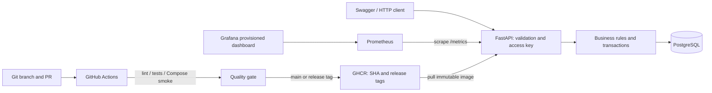

# Архитектура

## Компоненты и поток запроса

Монолит с разделением HTTP, схем, бизнес-сервисов и хранения. Синхронные SQLAlchemy
и Psycopg соответствуют синхронным FastAPI handlers; один процесс Uvicorn.
Один процесс выбран явно, чтобы in-process Prometheus counters имели однозначный
смысл. Масштабирование на несколько workers потребует отдельной конфигурации метрик.

## Транзакции

Создание брони блокирует строку площадки, проверяет доступность и вместимость,
вставляет бронь и делает commit. Отключение площадки берёт ту же блокировку.
Отмена блокирует сначала площадку, затем обновляет заблокированную бронь.
Таким образом, проверка доступности и её изменение не расходятся при конкуренции.

Независимая гарантия БД: exclusion constraint для facility_id и
`tstzrange(starts_at,ends_at,'[)')`, только при status='confirmed'.
Даже прямой INSERT в обход сервисного слоя не создаст пересечение.
SQLSTATE 23P01 превращается в доменный booking_conflict/409.
Неуспешная транзакция откатывается; успешный HTTP-ответ выдаётся после commit.

Сериализация операций на одной площадке — осознанный компромисс небольшого сервиса.
Разные площадки используют разные блокировки. Redis/распределённая блокировка не нужны.

## Данные и конфигурация

Две таблицы, UUID, внешние ключи, CHECK constraints и индексы под фильтры.
Миграция содержит собственный снимок DDL и не зависит от будущих ORM-моделей.
Миграции применяет отдельный одноразовый Compose-сервис; API ждёт его успешного завершения.
Идемпотентный demo seed создаёт только недостающие площадки по уникальному имени.

PostgreSQL использует постоянный том, тестовая БД — отдельный tmpfs.
Секреты хранятся только локально в .env или в окружении. В Git — пустой шаблон.
Настройки часов работы и длительности валидируются при старте.

## Наблюдаемость и отказ

HTTP счётчики и гистограмма используют method/шаблон маршрута/status.
Идентификаторы записей и клиентов в метки не включаются. /metrics исключён из учёта
HTTP-запросов. Бизнес-счётчики увеличиваются только после успешного commit;
повторная отмена не считается второй отменой.

`up` отвечает на вопрос о возможности scrape. `app_ready` дополнительно проверяет БД.
При отказе БД бизнес-операции и /health возвращают 503, /metrics остаётся доступен.
Таймауты подключения, пула и SQL ограничены. После восстановления БД pre-ping пула
позволяет продолжить работу без ручного перезапуска API.

Логи JSON: request_id, HTTP method, route template, status, duration_ms.
Access log Uvicorn отключён, чтобы URL с query-параметрами не дублировал данные клиентов.
Пользовательские тела запросов, ключи и database URL не логируются приложением.

## Доставка

CI проверяет код и полный стенд на Linux amd64. Локально проверяется Apple Silicon arm64.
Runtime-образ собирается в два этапа, работает под UID 10001 и не содержит dev-зависимостей.
Базовые образы закреплены manifest digests; официальные Actions — commit SHA.
Основной ветке соответствуют проверенный SHA-тег и OCI revision label.
Релизный тег имеет отдельное имя, для строгой воспроизводимости используется digest.

Доставка на Mac выполняется явным pull и Compose up выбранного образа.
Автоматического доступа CI к персональному Mac и публичного облачного сервера нет.
Публикация образа автоматическая, развёртывание локального стенда — управляемое.
